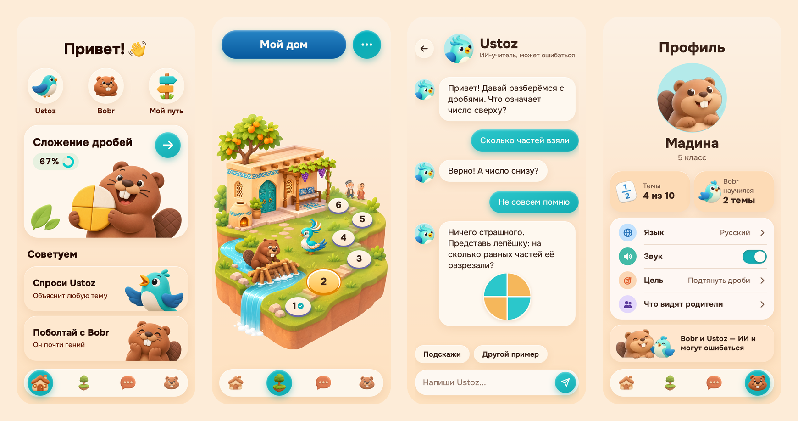
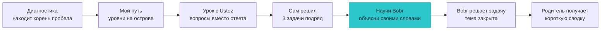
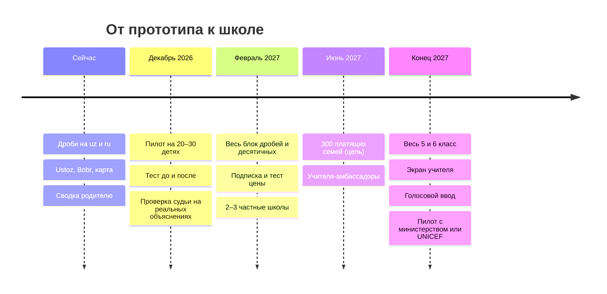
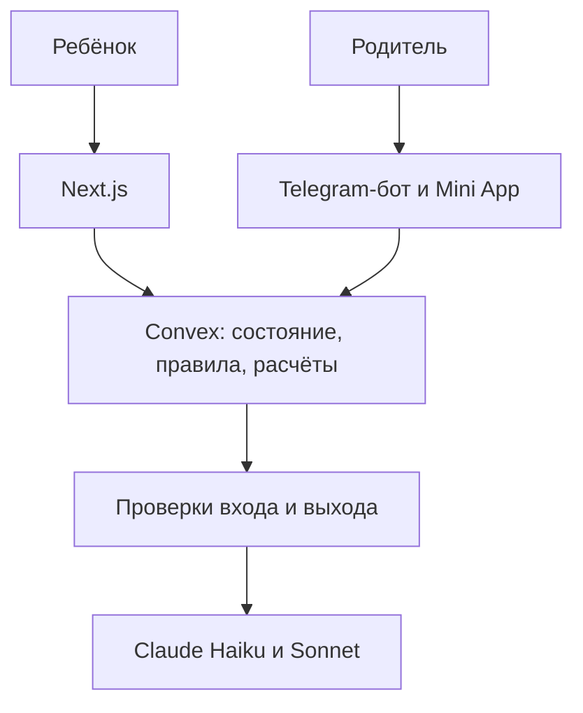

<div align="center">


# Bobr

### Ребёнок учит бобра дробям и сам начинает их понимать

ИИ-репетитор по математике для детей 11–12 лет на узбекском и русском языках.


[Как это работает](#как-это-работает) · [Что готово](#что-уже-работает) · [Роадмап](#роадмап) · [Запуск](#запуск)

</div>

<p align="center">
  
</p>

## Проблема

**81 % подростков Узбекистана не достигают базового уровня по математике.** Так показал PISA 2022: уровень 2 и выше есть только у 19 %, в среднем по ОЭСР у 69 %.

Дроби часто ломаются на одной и той же ошибке:

```text
1/2 + 1/3 = 2/5
```

Ребёнок складывает числители и знаменатели. Если ChatGPT просто выдаст верный ответ, домашка будет сделана, а ошибка останется. В исследовании Bastani и соавторов (PNAS, 2025) школьники с неограниченным GPT-4 на практике решали на 48 % лучше, а на экзамене без ИИ показали результат на 17 % хуже.

Репетитор помогает, но стоит дорого и есть не у всех.

## Идея

В Bobr ответ нельзя выпросить. Его нужно понять, а потом объяснить тому, кто уверен, что всё знает.

**Bobr** считает себя гением. Это наглый бобр. Он ошибается с полной убеждённостью и учится только у ребёнка. **Ustoz** это спокойная птица Хумо. Она задаёт вопросы и ведёт к решению, но готовый ответ не даёт.

## Как это работает



Если ребёнок ошибается в сложении дробей, система идёт вниз по графу тем и ищет, где знание оборвалось. После этого строится личный маршрут, а не общий список уроков.

## Что отличает Bobr

| | Чат-бот с ответами | Решение по фото | **Bobr** |
|---|:---:|:---:|:---:|
| Даёт готовый ответ | да | да | **нет** |
| Находит конкретный пробел | редко | нет | **да** |
| Ребёнок объясняет сам | нет | нет | **да** |
| Числа проверяет код | обычно нет | зависит от сервиса | **да** |
| Родитель видит прогресс, а не переписку | нет | иногда | **да** |

Главный принцип продукта: **код решает, модель говорит.** Ответ, вердикт и переход к следующему шагу считает программа. Модель подбирает слова и не может объявить неверный ответ верным.

## Что уже работает

| Часть | Состояние |
|---|---|
| Вход, раскрытие ИИ, выбор языка, цель | ✅ |
| Адаптивная диагностика и личный план | ✅ |
| Карта «Мой дом» с шестью уровнями | ✅ каждый уровень открывает настоящий урок |
| Уроки по 7 темам дробей | ✅ задачи генерирует и проверяет код |
| Ustoz в уроке и в чате | ✅ ведёт вопросами |
| Чат с Bobr | ✅ с лимитами времени |
| «Научи Bobr» | ✅ судья проверяет объяснение, Bobr пробует решить |
| Telegram-бот и кабинет родителя | 🧪 основа готова, часть команд ещё в работе |
| Проверки безопасности | ✅ критические атаки: 30 из 30 заблокированы в нашем наборе |

Эффект на обучении мы ещё не измеряли. Первая проверка до и после занятий запланирована на пилот.

## Роадмап



<details>
<summary><b>Что входит в каждый этап</b></summary>

**Доказать ядро, декабрь 2026**
- [ ] Вычитка всех текстов носителем и проверка кризисного сценария специалистом
- [ ] Судья на 50+ размеченных детских объяснениях
- [ ] Сессии 1:1 с пятиклассниками и учителем-экспертом
- [ ] Закрытый пилот на 20–30 детях, тест до и после, отложенная проверка

**Доказать, что это нужно семьям, февраль 2027**
- [ ] 8–10 тем блока «Дроби и десятичные» и темы-предшественники из 4 класса
- [ ] Конвейер новой темы: не больше 3 человеко-дней
- [ ] Подписка с бесплатной неделей, тест цены 39 и 49 тысяч сумов
- [ ] Политика конфиденциальности, журнал согласий, удаление данных

**Масштабирование, 2027**
- [ ] Весь 5 класс, затем 6 класс
- [ ] Экран учителя: типичные ошибки класса и тема недели
- [ ] Голосовой ввод без хранения аудио
- [ ] Контролируемое исследование на 300–1000 учениках
- [ ] Интеграция с eMaktab, если появится открытый API

</details>

## Безопасность детей

Продукт рассчитан на детей, поэтому защита встроена в каждый ход:

- имя, телефон, адрес и школа маскируются до базы и до модели;
- свободный текст проходит проверку кодом и модерацию;
- ответ модели проверяется перед показом;
- при признаках кризиса ребёнок видит экран с обращением к взрослому;
- родитель получает сводку, но не читает переписку;
- интерфейс прямо говорит, что Ustoz и Bobr это ИИ и они могут ошибаться.

> **Важно.** Это прототип хакатона. Текст кризисного экрана и узбекские материалы ещё должны проверить специалист и носитель языка. С настоящими детьми продукт пока не используется.

## Как устроено



**Стек:** Next.js 16 · React 19 · TypeScript · Convex · Tailwind CSS · Framer Motion · Zod · fraction.js · Python и aiogram.

## Запуск

Нужны Node.js 22 и ключ Anthropic.

```bash
nvm install 22 && nvm use 22
npm install
npm run dev:convex
```

Во втором терминале:

```bash
bash scripts/set-anthropic-key.sh
npx convex env set DEMO_ALLOW_ANON 1
npm run dev
```

Откройте http://localhost:3000.

```bash
npm run verify                          # типы, тесты, Convex
npx vitest run tests/demo-path.test.ts  # демо-путь
```

Выкатка описана в [docs/DEPLOY.md](docs/DEPLOY.md), спецификация лежит в [docs/BOBR_SPEC.md](docs/BOBR_SPEC.md), исследования и источники цифр собраны в [knowledge/research](knowledge/research/README.md).

## Как это сделано

Код писался с помощью ИИ-агентов. В `.claude/` и `.agents/` лежат инструменты разработки: скиллы и настройки агентов, часть из них взята из наших прошлых проектов и открытых наборов. Оттуда же адаптирован `scripts/ui-check.mjs`. Правила переноса описаны в [docs/01_HARNESS_SETUP.md](docs/01_HARNESS_SETUP.md).
