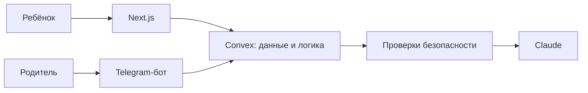

# Bobr

ИИ-репетитор по дробям для детей 11–12 лет на узбекском (латиница) и русском языках.

Ребёнок проходит короткую диагностику и получает план тем. Ustoz ведёт его вопросами и не выдаёт готовый ответ. Когда тема освоена, ребёнок объясняет её бобру Bobr: лучше всего понимаешь то, чему можешь научить другого.

> Статус: прототип хакатона. Текст кризисного экрана и узбекские тексты ещё должны проверить специалист и носитель языка, поэтому с настоящими детьми продукт пока не используется.

## Что есть в продукте

| Экран | Что делает |
|---|---|
| Вход, цель, диагностика, план | раскрытие ИИ, выбор языка, адаптивная проверка знаний, порядок тем |
| Главный | следующая тема, прогресс, быстрый вход к Ustoz, Bobr и карте |
| Мой дом | остров с шестью уровнями, каждый открывает настоящий урок |
| Урок | задачи по дробям, рисунки, подсказки, реакции Ustoz |
| Чат | разговор с Ustoz и Bobr с лимитами времени |
| Научи Bobr | ребёнок объясняет тему, код и судья проверяют объяснение |
| Профиль | язык, цель, прогресс, что видят родители |

Родителям предназначены Telegram-бот (`bot/`) и Mini App (`app/parent/`).

## Как устроено



Главное правило: **код решает, модель говорит.** Ответы, вердикты, переходы и уровень темы считает код. Дроби хранятся строками и считаются через `fraction.js`. Модель только подбирает слова, а её вывод проходит схему и проверки.

Стек: Next.js 16, React 19, Convex, TypeScript, Tailwind, Framer Motion, Zod, Claude Haiku и Sonnet, Python и aiogram для бота.

## Безопасность детей

- Личные данные маскируются до записи в базу и до отправки модели.
- Сообщения проходят проверку кодом и модерацию, ответы модели проверяются отдельно.
- При признаках кризиса ребёнок видит экран с обращением к взрослому и номером помощи.
- Интерфейс всегда сообщает, что Ustoz и Bobr это ИИ и они могут ошибаться.

Набор проверочных атак лежит в `tests/redteam/`.

## Запуск

Нужны Node.js 22 и ключ Anthropic.

```bash
nvm install 22 && nvm use 22
npm install
npm run dev:convex
```

Во втором терминале:

```bash
bash scripts/set-anthropic-key.sh
npx convex env set DEMO_ALLOW_ANON 1
npm run dev
```

Приложение откроется на http://localhost:3000.

## Проверка

```bash
npm run verify
npx vitest run tests/demo-path.test.ts
bash scripts/turn-smoke.sh
```

Выкатка на сервер или Vercel описана в [docs/DEPLOY.md](docs/DEPLOY.md), продуктовая спецификация лежит в [docs/BOBR_SPEC.md](docs/BOBR_SPEC.md).

## Заимствования

Код писался с помощью ИИ-агентов. Папки `.claude/` и `.agents/` содержат инструменты разработки: скиллы и настройки агентов, часть взята из наших прошлых проектов и открытых наборов. `scripts/ui-check.mjs` адаптирован из нашего проекта Mentorium. Правила переноса записаны в [docs/01_HARNESS_SETUP.md](docs/01_HARNESS_SETUP.md).
