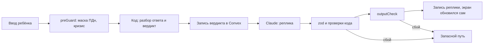
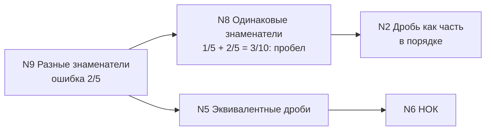

# Bobr: подготовка к защите у менторов

Состояние на 18.11.2026, 14:15, ветка `main`. 15 критериев, каждый от 1 до 10. Балл ментора равен среднему по его пяти пунктам, поэтому слабый B4 стоит столько же, сколько сильный T1.

Метки: **[проверено]** запускали сегодня; **[журнал]** записано в базе команды, сегодня не перепроверяли; **[план]** ещё не сделано; **[предложение]** наше решение, которое надо подтвердить.

## 1. Что решить до прихода менторов

| # | Вопрос | Почему важно | Что советую |
|---|---|---|---|
| 1 | Экран «Научи Bobr» пустой: поле ввода не подключено к бэкенду | Это главная идея продукта, и на экране её сейчас не показать | Подключить `teach:start` и `teach:explain` к экрану, если успеваете. Иначе сказать прямо: бэкенд работает, экран подключаем сегодня |
| 2 | Бизнес-модели в репозитории нет | Весь блок B держится на ней | Подтвердить или поменять раздел B2. Цена 39 000 сум моя, рынком не проверена |
| 3 | Кто что делал и какой опыт у команды | T4 оценивает людей, я этого не знаю | Заполнить строки `[впишите]` в T4 |
| 4 | Ни одного ребёнка, родителя или учителя мы не спрашивали (в репозитории нет таких данных) | Менторы B и S спросят первым делом | Сегодня показать продукт 2–3 родителям или учителю из зала и записать фразы. Если такие разговоры уже были, вписать их |
| 5 | Кто выступает | Менторы читают слайды на узбекском | Узбекскую речь ниже должен вычитать носитель |

## 2. Речь на 30 секунд

**По-русски.** В PISA 2022 только 19 % школьников Узбекистана дошли до базового уровня по математике. Дроби в 5 классе ломают всё, что идёт дальше. Bobr находит настоящую причину ошибки, строит ребёнку личный план, а потом ребёнок сам объясняет тему глупому бобру. Ответы и вердикты считает код, поэтому ИИ не скажет «верно» на неверный ответ. Работает на узбекском и русском.

**Oʻzbekcha (вычитать носителю).** PISA 2022 natijalariga koʻra, Oʻzbekistonda oʻquvchilarning atigi 19 foizi matematikada bazaviy darajaga yetgan. Kasrlar 5-sinfda keyingi mavzularning poydevori. Bobr xatoning asl sababini topadi, bolaga shaxsiy reja tuzadi, keyin bola mavzuni qunduz Bobrga oʻzi tushuntiradi. Javob va bahoni kod hisoblaydi, shuning uchun sunʼiy intellekt notoʻgʻri javobni “toʻgʻri” demaydi.

## 3. Карта критериев

| Пункт | Что есть сейчас | Риск | Что поднимет балл |
|---|---|---|---|
| T1 Реализация | Сквозной бэкенд, экраны до урока | средний | Экран «Научи Bobr» |
| T2 Готовность кода | 503 теста, verify зелёный | низкий | Показать прогон |
| T3 Инновационность | «Код решает, ИИ говорит» + ребёнок учит | низкий | Показать проверку ответа |
| T4 Знания команды | Зависит от ответов вслух | средний | Отрепетировать вопросы ниже |
| T5 Стек | Каждый выбор объясним | низкий | Таблица T5 |
| B1 Идея и проблема | Сильные внешние данные | низкий | Разговор с родителем |
| B2 Модель | Только предложение | **высокий** | Подтвердить модель |
| B3 Преимущество | Отличия есть, конкуренты сильные | средний | Честно назвать Eduten |
| B4 Устойчивость | Замерена цена хода | **высокий** | Показать расчёт |
| B5 Рост | План этапами | средний | Пилот с датами |
| S1 Проблема | PISA, исследования | низкий | Пример ошибки `2/5` |
| S2 Глубина | Граф тем, заблуждения | средний | Учитель в команду или советники |
| S3 Применение | Пилота нет | **высокий** | План пилота |
| S4 Законы | Часть закрыта, есть дыры | **высокий** | Назвать дыры и срок |
| S5 Эффект | Измерений нет | средний | Метрики пилота |

---

## 4. Технический ментор

### T1. Техническая реализация

**Что сказать.** Это машина состояний в коде. ИИ подбирает слова, а числа, вердикты и переходы считает программа.

| Что работает | Статус |
|---|---|
| Урок: `1/2 + 1/3 = 2/5` распознан как заблуждение M9, Ustoz ведёт вопросами | [проверено] живой Claude |
| Цель → диагностика → план → махалля на бэкенде, план N8 → N6 → N5 → N9 | [проверено] смоук, 18 из 18 шагов |
| Экраны ребёнка до урока на настоящем API | [журнал] |
| Кризис: оверлей, выход с сохранением урока | [проверено] смоук |
| «Научи Bobr», бэкенд: Bobr ошибается, задаёт вопрос, учится, дом становится `alive` | [проверено] один полный успех, см. ниже |
| «Научи Bobr», экран | **[план]** заглушка |
| Telegram-бот и кабинет родителя | [журнал] на тестовых заглушках, реальная отправка не проверена |
| Болталка, миры, ночной крон «дом гаснет» | **[план]** |

**Что показать.** Диагностику, план, махаллю и урок с ответом `2/5`. Для сцены с Bobr эта фраза прошла судью на живом Claude (один прогон, не гарантия):

> Сначала приводим к общему знаменателю: половина это 3 куска из 6, треть это 2 куска из 6. Куски одинаковые, значит складываем только верхние числа.

**Не вводить на демо:** объяснение с готовым ответом `5/6`. Guard принял его за выманивание ответа, и сцена вернула `retry` без реплики. Из четырёх сильных объяснений сегодня судья сразу принял одно, на остальных Bobr задал уточняющий вопрос или сработал этот guard. Узбекское объяснение дошло только до вопроса.

**Вопрос: «Сколько ждать ответа?»** Ход урока сегодня занимал 3,2–4,6 с. В сцене с Bobr один шаг проверки занял 7,9 с. Следующий шаг: стриминг реплики и параллельная проверка.

### T2. Готовность кода

| Проверка | Результат |
|---|---|
| `npm run verify` | [проверено] tsc Next, tsc Convex, vitest, Convex codegen: все PASS |
| Юнит-тесты | [проверено] 503 из 503, 34 файла |
| Смоук урока и этапа 3 | [проверено] 18 из 18; сам скрипт не считает реплики ИИ проверенными |
| Red-team | [проверено] 40 детерминированных случаев из 58; 18 случаев и вердикты LLM-guard не запускали |
| Eval судьи 18 + 3 | **[план]** |
| Объём | около 8 000 строк продукта, 2 400 строк тестов, 84 коммита |

**Сказать сразу, до вопроса:** это хакатонная сборка на локальном Convex. Вход в урок ещё частично работает по `studentId` в демо-режиме. До публичного запуска его убираем, это записано в `BLOCKERS.md` (B9).

### T3. Инновационность

Три вещи, которых нет в обычной обёртке над чат-ботом:

1. **ИИ не может соврать про математику.** Вердикт записывается до вызова модели. Дроби хранятся строкой и считаются через fraction.js, без float.
2. **Реплика проверяется кодом.** `numberCheck` ловит чужие числа, `leakDetector` ловит выданный ответ, в том числе словами («две трети», «yarim»). Цитата судьи обязана быть подстрокой текста ребёнка.
3. **Ребёнок сам объясняет тему.** Bobr приходит с ошибкой самого ребёнка, ответ Bobr считает код.

### T4. Знания команды

`[впишите]`: кто что делал, опыт каждого, один сложный баг, который чинили сами.

Отрепетировать ответы вслух:

| Вопрос | Ответ |
|---|---|
| Почему не агент? | Ребёнку нельзя получить неверное «верно». Переходы должны быть предсказуемы и покрыты тестами |
| Почему дробь строкой? | `0.1 + 0.2` ломает сравнение, а BigInt из fraction.js не сериализуется в Convex |
| Почему вердикт пишется до LLM? | Сбой модели не меняет результат ребёнка |
| Что если Claude упал? | Таймаут, один повтор, запасной путь. Ustoz упал: компонент и кнопка подсказки. После трёх ошибок 429/529 за 30 с остаются только задачи |
| Как защищаетесь от prompt injection? | Текст ребёнка идёт в промпт внутри тегов как данные, выход проходит схему и проверки кода |
| Писали с ИИ? | Да, с агентами. Архитектуру, правила и приёмку задаёт команда, каждое изменение проходит типы и тесты. Отвечать так, только если каждый может объяснить свою часть |

### T5. Стек

| Слой | Выбор | Почему |
|---|---|---|
| Интерфейс | Next.js 16, React 19, TypeScript | Один язык с бэкендом, типы на всём пути |
| Бэкенд и база | Convex | Атомарные мутации и живые подписки, дом обновляется без опроса. Есть локальный режим для демо |
| Реплики и проверка | Claude Haiku 5.5 | Дешёвый и быстрый: guard, outputCheck, Bobr |
| Учитель и судья | Claude Sonnet 5.5 | Сократовский диалог и оценка объяснения сложнее |
| Структурный вывод | zod + `messages.parse` | Ответ модели либо проходит схему, либо идёт в запасной путь |
| Математика | fraction.js | Точные дроби |
| Анимация | framer-motion, CSS, SVG | Без тяжёлых 3D-библиотек |
| Родитель | Python, aiogram, Telegram Mini App | Канал, который у родителей уже открыт |

---

## 5. Бизнес-ментор

### B1. Идея и актуальность проблемы

Семья платит за репетитора, школа не успевает разбирать ошибки каждого. По двум объявлениям OLX в Ташкенте час стоит 100 000–200 000 сум (это примеры, рыночной статистикой не считать). При средней зарплате около 5,8 млн сум регулярный репетитор доступен не всем.

**Наша ставка:** родитель готов платить за понятный результат: «ребёнок закрыл пробел и объяснил тему сам». Эту ставку ещё надо проверить.

### B2. Бизнес-модель [предложение]

| Канал | Кто платит | Цена | Роль |
|---|---|---|---|
| Пилот со школами | никто | 0 | Доказать эффект, получить данные |
| Семейная подписка | родитель в Telegram | 39 000 сум в месяц (около $3,3) | Первая выручка |
| Школа или хокимият | бюджет или спонсор | лицензия на ученика, цена после пилота | Масштаб |

Ориентиры цены: Khanmigo около $4 в месяц (по обзорам, у Khan Academy не сверяли), один час репетитора по объявлениям от 100 000 сум. Детям не продаём ничего: монет, магазина и рекламы нет.

### B3. Конкурентное преимущество

| Кто | Что делает | Чем отличаемся |
|---|---|---|
| Репетитор | Живой человек, дорого | Доступен каждый день, месяц подписки дешевле одного часа по объявлениям |
| ChatGPT и похожие | Легко выдают ответ | Bobr ответ не выдаёт, код проверяет математику |
| Eduten | ИИ-платформа по математике. Пилот UNICEF: 1 046 пятиклассников, 17 школ Ташкента, рост навыков 16,9 % | Сильный игрок и доказательство спроса. У нас диалог, поиск корня ошибки, «научи другого» |
| Qalan | Математика на казахском, русском и узбекском, видео и задачи | Персонаж, объяснение ребёнка, родительская сводка |
| Khanmigo | Сократовский ИИ-наставник | Узбекская латиница, программа и контекст Узбекистана |

**Что защитит нас через год:** банк узбекских заблуждений и формулировок, данные о том, какие объяснения работают, доверие родителей и школ. Модель как таковая преимуществом не считается, её может купить любой.

### B4. Финансовая устойчивость

Токены одного хода урока [проверено, один замер]:

| Шаг | Вход | Кэш | Выход | Цена |
|---|---:|---:|---:|---:|
| Ustoz, Sonnet 5.5 | 149 | 4 480 | 117 | $0,00192 |
| outputCheck, Haiku 5.5 | 75 | 909 | 18 | $0,00003 |
| **Итого за ход** | | | | **≈ $0,002** |

Цены API: Sonnet $2 / $10 за млн токенов, чтение кэша $0,10; Haiku $0,10 / $0,50. Для чтения кэша Haiku принято $0,01.

| Месячная модель на ребёнка (допущения) | Значение |
|---|---:|
| 3 занятия в неделю по 20 ходов | 260 ходов |
| Ходы | $0,50 |
| Запись кэша, худший случай | $0,23 |
| Округляем с запасом на судью (его токены не мерили) | **$1 ≈ 12 000 сум** |
| Подписка | 39 000 сум |
| Остаётся до комиссий и налогов | **27 000 сум, 69 %** |

| Сценарий | Расчёт |
|---|---|
| 5–6 классы | 6,87 млн школьников / 11 классов × 2 ≈ 1,25 млн |
| 1 % платит | 12 500 семей |
| Выручка | ≈ 487 млн сум, около $41 000 в месяц |
| Переменные расходы | около $12 500 в месяц |
| Безубыточность при постоянных $5 000 в месяц | около 2 200 платящих семей |

Это арифметика, прогнозом её не называть. Цену привлечения и удержание мы не знаем: их покажет пилот.

### B5. Возможности роста

| Этап | Что делаем | Как поймём, что готово |
|---|---|---|
| 1. Сейчас | Закрываем экран Bobr, контент N1–N10, вычитку узбекского | Демо идёт без ручных обходов |
| 2. Пилот | 3 школы, около 300 пятиклассников, 6 недель | Рост теста к контрольной группе |
| 3. Платный запуск | Подписка через Telegram родителя | Первые платящие, удержание через месяц |
| 4. Шире | Вся математика 5–6 классов | Те же метрики на новых темах |
| 5. Регион | Казахский, таджикский, киргизский | Партнёр в стране и вычитка носителем |

Канал дешёвый: по оценке агентства Wunder Digital, в Telegram около 25 млн пользователей в Узбекистане.

---

## 6. Ментор сферы (образование)

### S1. Актуальность проблемы

- PISA 2022: **19 %** учеников Узбекистана достигли уровня 2 по математике, в среднем по ОЭСР 69 %.
- В школах 6,87 млн учеников и 11 118 школ (2025/26). Учитель физически не разберёт ошибку каждого.
- Знание дробей и деления в 5 классе предсказывает алгебру и общий уровень математики в старшей школе через 5–6 лет, даже с учётом IQ и доходов семьи (Siegler et al., 2012; данные США и Великобритании).

**Осторожно:** за 2025 год ОЭСР, по найденным сводкам, не опубликовала балл Узбекистана по математике. Рост естественных наук с 355 до 438 в ответ на вопрос не приписывать математике. Средний балл за 2022 в источниках расходится (364 и 368), поэтому называть процент 19 %.

### S2. Глубина понимания сферы

Ответ на примере. Ребёнок пишет `1/2 + 1/3 = 2/5`. Обычная система скажет «неверно». Bobr видит заблуждение M9, «сложил числители и знаменатели», идёт вниз по графу и строит план N8 → N6 → N5 → N9:

Педагогические основания:

- **Эффект «научи другого».** Chase et al. (2009): ученики вкладывали больше усилий, когда обучали компьютерного персонажа, сильнее всего выигрывали слабые.
- **Ответ не выдаём.** Bastani et al. (PNAS, 2025): около 1 000 школьников, обычный чат-бот дал +48 % на практике и −17 % на экзамене без него. Версия с ограничениями в основном убрала этот вред.
- **Три уровня темы:** пробел → решил сам (3 верных подряд без подсказок) → научил Bobr.

**Слабое место:** контент есть для демо-пути, файлов заблуждений и чек-листов нет. Педагога-методиста в репозитории не видно. `[впишите]`, если он есть.

### S3. Практическое применение

Ребёнок занимается дома или на уроке с телефона или школьного ноутбука. Родитель видит сводку в Telegram. Учитель в MVP не входит и станет следующим шагом.

**Честный статус:** с детьми не тестировали.

**План пилота [предложение]:** 3 школы, около 300 пятиклассников, 6 недель, 2–3 занятия по 15–20 минут в неделю, контрольные классы, один тест по дробям до и после. Прямые расходы на ИИ около $450 при $1 на ребёнка в месяц.

### S4. Соответствие законам

| Требование | Что у нас | Статус |
|---|---|---|
| ЗРУ-547, ст. 21 ч. 4: согласие за несовершеннолетнего дают родители, письменно | Кнопка согласия в боте, значение сохраняется | Частично. Надо хранить дату и подтвердить у юриста, что кнопка подходит как письменная форма |
| ЗРУ-547, ст. 15 и 27¹: передача за рубеж | Текст ребёнка уходит в Claude (США) после маски ПДн | **Дыра.** В тексте согласия про передачу за рубеж ничего нет. Нужны основание и отдельная строка |
| ст. 27¹ с 27.03.2026: биометрия, генетика и данные абонентов связи хранятся в стране | Биометрию не собираем | В порядке |
| Право удалить данные | Бот обещает `/delete`, удаления на сервере нет | **Дыра.** Закрыть до реальных пользователей |
| ЗРУ-1115 (21.01.2026): нельзя опираться только на вывод ИИ в юридически значимых решениях; штраф за незаконную обработку ПДн с помощью ИИ | Оценки в школе не ставим, вердикты считает код | В порядке |
| Раскрытие ИИ (правила Anthropic для продуктов с несовершеннолетними) | Плашка «Bobr — ИИ и может ошибаться», персонажи не называют себя живыми | В порядке |
| Правила Anthropic: модерация, мониторинг, подтверждение возраста, публичное заявление о соответствии законам | Модерация есть. Возраста и публичной страницы нет | Частично |

Безопасность ребёнка: маска ПДн до модели и базы, 13 категорий риска, кризисный оверлей. Родителю не уходит сигнал, если подозрение на насилие дома. **Что честно назвать:** кризисный текст пока заглушка, подтверждён только номер 112, на удержанный сигнал пока никто не реагирует в реальном времени (B7, B2, B11). Узбекский список триггеров не вычитан носителем.

Сказать: «Юридическую проверку ещё не проходили, до пилота пройдём». Юристами себя не называть. Закон о защите детей от вредной информации мы по первоисточнику не читали.

### S5. Масштаб эффекта

Обещать результат рано. Обещать можно измерение:

| Метрика | Как считаем |
|---|---|
| Прирост по тесту дробей | До и после, против контрольных классов |
| Закрытые пробелы | Темы из `gap` в `solved_self` |
| Глубокое понимание | Доля тем `taught_bobr` |
| Удержание знаний | Повтор через 7 дней |
| Доступность | Доля занятий на узбекском и вне Ташкента |

Ориентир для разговора: у Eduten в 12-недельном пилоте рост навыков 16,9 %. Это их результат, нам он не принадлежит.

---

## 7. Чего не говорить

| Не говорить | Почему | Сказать вместо |
|---|---|---|
| «Дом у родителя оживает в ту же секунду» | Сегодня этого не наблюдали | «Так спроектировано, запись идёт атомарно, показ родителю проверяем» |
| «Работает на всех темах» | Контент только на демо-путь | «Сквозной путь готов, контент расширяем» |
| «Red-team 30 из 30» | Не запускали | «40 детерминированных случаев проходят» |
| «Дети учатся лучше» | Нет данных | «Это гипотеза, пилот её проверит» |
| «Конкурентов нет» | Eduten уже был в школах Ташкента | Таблица B3 |
| «Данные не покидают страну» | Текст уходит в Claude | «ПДн маскируем до отправки» |

## 8. Найдено при подготовке

- Задачи N9 после первой бывают тяжёлыми для 5 класса: сегодня генератор выдал ответ `103/63`. На демо лучше не задерживаться на них.
- В узбекской реплике Bobr встретился прямой апостроф (`bo'laklar`), правило проекта требует `ʻ`.
- Живой прогон «Научи Bobr» создал тестовых учеников в локальной базе. Перед показом нужен `scripts/demo-reset.sh`.

## 9. Источники

- [PISA 2022, страница Узбекистана, ОЭСР](https://www.oecd.org/en/publications/pisa-2022-results-volume-i-and-ii-country-notes_ed6fbcc5-en/uzbekistan_2bb94bf1-en.html) (страница закрыта для автоматического чтения, цифра взята из поисковой выдержки; открыть перед цитированием)
- [PISA 2025, страница Узбекистана, ОЭСР](https://www.oecd.org/en/publications/pisa-2025-results-volume-i-country-notes_2d4ff9ea-en/uzbekistan_f977081e-en.html) (то же)
- [Число школьников](https://anhor.uz/news/chislo-4/), [11 118 школ](https://talimxabarlari.uz/ru-uz/71448/)
- [ЗРУ-547 на lex.uz](https://lex.uz/docs/4396419), [поправки марта 2026, Kun.uz](https://kun.uz/ru/news/2026/03/28/xraneniye-nekotoryx-personalnyx-dannyx-za-predelami-uzbekistana-razresheno), [ЗРУ-1115 на lex.uz](https://lex.uz/ru/docs/8011377)
- [Правила Anthropic для продуктов с несовершеннолетними](https://support.claude.com/en/articles/9307344-responsible-use-of-anthropic-s-models-guidelines-for-organizations-serving-minors)
- [Пилот Eduten, UNICEF](https://www.unicef.org/innovation/reports/transforming-maths-learning-uzbekistan), [обзор EdTech Центральной Азии (Qalan)](https://astanahub.com/en/article/obrazovanie-bez-granits-tsifrovye-resheniia-ot-kazakhstanskikh-startapov-uchastnikov-astana-hub)
- [Siegler et al., 2012](https://www.psychologicalscience.org/journals/psychological-science/0956797612440101/), [Chase et al., 2009](https://purl.stanford.edu/zm369yx3532), [Bastani et al., 2025](https://papers.ssrn.com/abstract=4895486)
- [Khanmigo, обзор цены](https://www.kidsaitools.com/en/articles/khanmigo-review-2026), [Telegram в Узбекистане](https://uzdaily.ru/en/telegram-76-reach-youtube-no-1-e-commerce-on-the-rise-inside-uzbekistans-digital-landscape/), [объявления репетиторов, OLX](https://www.olx.uz/tashkent/q-%D1%80%D0%B5%D0%BF%D0%B5%D1%82%D0%B8%D1%82%D0%BE%D1%80-%D0%BC%D0%B0%D1%82%D0%B5%D0%BC%D0%B0%D1%82%D0%B8%D0%BA%D0%B8), [средняя зарплата, пересказ данных Госкомстата](https://anhor.uz/vzglyad-iznutri/too-expensive-2/)
